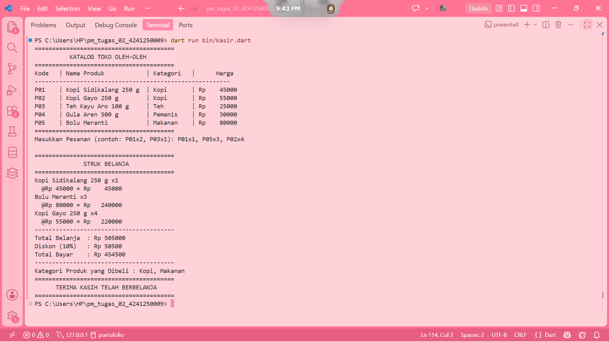
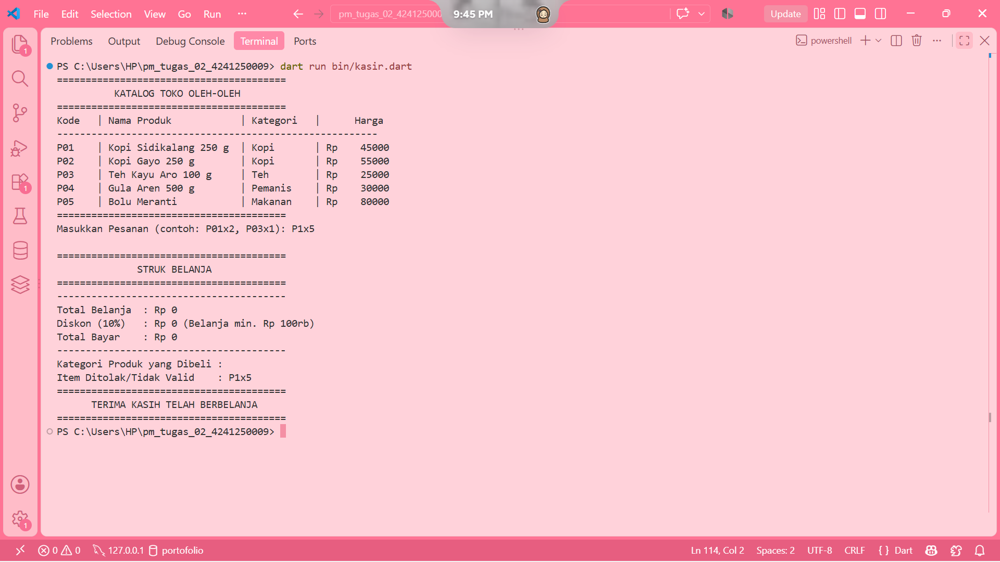

# Tugas Rutin 2 - Aplikasi Console Kasir Sederhana
Mata Kuliah: Pemrograman Mobile (PSIK 24C / Semester 5)  
Universitas Negeri Medan (UNIMED)

## A. Identitas Mahasiswa
- **Nama:** Sofia Zahra
- **NIM:** 4241250009
- **Kelas:** PSIK 24C
- **Program Studi:** Ilmu Komputer - Universitas Negeri Medan

## B. Tangkapan Layar Eksekusi Program

### 1. Skenario Pesanan Valid

### 2. Skenario Pesanan Mengandung Kode Salah / Format Tidak Valid

## C. Penjelasan Konsep Pemrograman Dart
Dalam bahasa Dart, pemilihan kata kunci variabel sangat penting untuk menjaga kestabilan dan efisiensi memori program. Kata kunci `var` digunakan untuk variabel yang nilainya dapat diubah sewaktu-waktu dan tipe datanya disimpulkan secara otomatis oleh compiler. Sementara itu, `final` digunakan untuk variabel yang nilainya hanya diset sekali saat program berjalan (*runtime*), yang menjadikannya standar terbaik yang dianjurkan dalam praktik *Effective Dart*. Adapun `const` digunakan untuk nilai tetap yang sudah diketahui secara pasti sejak waktu kompilasi (*compile-time*). 

Selain itu, fitur *Sound Null Safety* pada Dart memastikan bahwa sebuah variabel tidak diperbolehkan bernilai `null` secara sembarangan, kecuali jika secara eksplisit diberi tanda tanya (`?`). Pada aplikasi kasir ini, *null safety* mencegah potensi terjadinya *runtime crash* ketika mengurai input pengguna menggunakan `int.tryParse()` atau saat memeriksa ketersediaan kunci di dalam `Map`. Jika nilai berpotensi kosong, Dart mewajibkan penanganan khusus menggunakan operator pengaman seperti `??` (*null-coalescing*) atau pengecekan kondisional `if`, sehingga aplikasi tetap berjalan stabil dan aman dari galat tak terduga.

---

## D. Pernyataan Penggunaan AI
Dalam pengerjaan Tugas Rutin 2 ini, asisten kecerdasan buatan (AI) dimanfaatkan sebagai sarana konsultasi teknis dan referensi penulisan struktur logika *parsing* input string, penggunaan metode koleksi fungsional seperti `.map()` dan `.fold()`, serta perapian tata letak tabel menggunakan fungsi pemformatan teks di Dart.